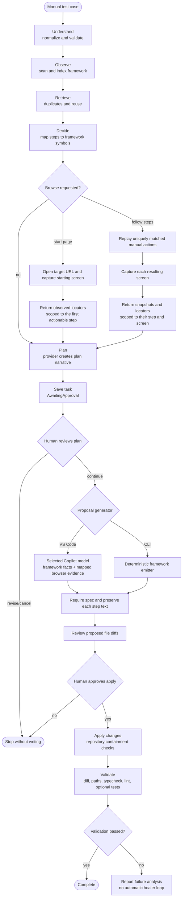

# TCOE TestPilot — Implemented Flow and Remaining Design

This document describes the workflow implemented in the repository as of the current
source, and marks the intended capabilities that are still pending. It supersedes the
older diagram image; the current visual is [`design_flow_chart.svg`](design_flow_chart.svg).

## Current workflow

The CLI separates the steps into `plan`, `resume`, `generate`, `apply`, and `validate` commands.
The VS Code flow presents the plan and diff in editor documents and asks before applying.
Plan state and a repository source snapshot are persisted before generation. `resume`
checks indexed source fingerprints and Git HEAD/branch before continuing;
generation and apply refuse to use a stale plan.

## Browser evidence boundary

The `packages/browser-tools` package provides a Playwright CLI adapter, an optional MCP
fallback, a session orchestrator, and a factory. Browser access is opt-in through CLI
`--browse` or an extension modal with **Follow Steps**, **Start Page Only**, and **Skip**
choices. Follow Steps warns that it can enter supplied test data and click controls,
including form submission and application data changes. The extension uses its configured
target URL, or extracts the first URL from the manual steps. The target URL must not contain
credentials.

Follow Steps replays explicit URLs and uniquely matched click and text-entry actions against
the live accessibility snapshot. It captures a new snapshot after each step. Locator
candidates are generated from observed refs and scoped to the step and screen where they
were seen; a reviewer still maps the candidate to the plan step. Ambiguous controls and
unsupported actions are not replayed automatically. Start Page Only captures the initial
screen and offers its candidates only for the first actionable step. MCP does not support
locator generation and yields no candidates. Steps without a selected candidate remain
TODOs rather than receiving a guessed locator.

The CLI supports `--target-url <url>` with `--browse`. MCP is disabled unless a command is
explicitly configured with `--browser-mcp-command`; optional arguments can be supplied
with `--browser-mcp-args`. The extension currently creates the CLI-primary browser session
without configuring an MCP fallback; extension MCP settings and fallback behavior remain
pending.

## Model boundaries

The extension passes a `vscode.lm` bridge into the provider-neutral runner and uses the
selected Copilot model for both planning and proposal generation. The bridge calls
`selectChatModels` and `sendRequest`; a live request in an extension host has not yet been
verified. The CLI has no VS Code host; its proposal path uses the deterministic emitter.
Neither a live Copilot request nor a live OpenAI-compatible request has been verified
against a real account in this project.

The installed Playwright browser utilities do not expose a TestPilot integration to the
official Planner, Generator, or Healer agents. The extension asks the selected Copilot
model for proposal files; the CLI uses TestPilot's deterministic framework emitter. Neither
flow calls the official Playwright Planner, Generator, or Healer agents.

## Approval and recovery

The CLI uses explicit user commands: `generate` follows plan review, and `apply` is the
write action. The extension has a plan continuation choice and a modal apply confirmation.
There is no separate persisted approval state for a generated proposal in the CLI.

Validation reports deterministic failure evidence. The `repair` command can request at most
two model repair proposals grounded in failed output and files TestPilot applied. Each
proposal is diffed and requires a separate explicit apply action; repair apply triggers
re-validation. The VS Code extension presents the same third approval gate. Official
Playwright Healer agents are not called.

## Completion status

Verified in the current workspace:

- Input normalization, framework indexing, duplicate detection, reuse planning, and task
  persistence.
- Binary `.xlsx` workbook parsing with worksheet and ambiguous-column selection.
- Reviewer-selected mapping from generated browser locator candidates to specific plan steps.
- Bounded evidence-based repair proposals with an explicit apply gate and re-validation.
- VS Code chat-style input, task history, stage progress, local task-history clearing, and index rebuild.
- Saved task continuation through `resume`, with repository drift checks before generation
  and apply.
- CLI plan, deterministic proposal generation, apply, and validation commands.
- VS Code extension 0.1.10 is packaged with step-by-step browser inspection. A live
  extension-host run against the user's application remains unverified.
- `npm run check:conformance` runs the standalone conformance checker; it is not part of
  `npm run check` and is not called by the extension generation path.
- The last recorded full check passed 154 tests before the latest model-generation changes;
  typecheck and packaging were verified after those changes, but the full suite has not
  been rerun.

Remaining: extension MCP fallback/configuration, live Copilot and browser checks, a complete
real-framework end-to-end run, conformance-checker integration decision, and reuse-quality
evaluation across representative manual cases.
